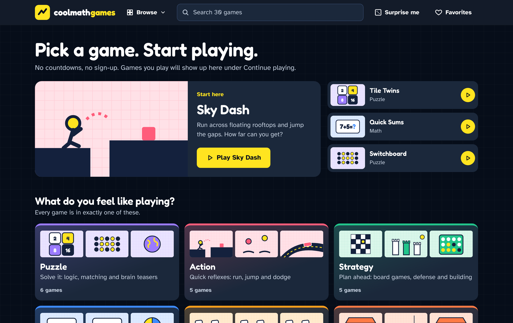

# Coolmath Games, redesigned

An unofficial student redesign concept of Coolmath Games by Tyler Beck and Colin Hill (CS 5167, Project 2: "If it is broke, fix it"). Built with SvelteKit (Svelte 5) as a static site. No backend.

Not affiliated with Coolmath Games. Game titles and thumbnail art are original placeholders.



## What the redesign fixes

Our critique ran two tasks on the live site: play a game you already know (Run 3), and find a new puzzle game and save it. Each fix below maps to a finding.

| Area | What we found | What the redesign does |
|---|---|---|
| Usability | Too many homepage sections compete for attention | Three sections: **Continue playing / Start here**, the six categories, **Popular right now** |
| Usability | Category and Top 10 rows get cut off at the right edge | All lists are wrapping grids |
| Learnability | Categories overlap (Skill vs. Logic); Logic has 9 subcategories | Six categories, one per game, each with a one-line description. Players, controls and length are **filters**, not categories |
| Learnability | Random, favorite and controls are unlabeled icons | Every button has a text label: Surprise me, Save to favorites, Restart, Full screen |
| Learnability | Controls hide behind an unlabeled gamepad icon | A **How to play** panel beside every game, plus the keys on the start screen |
| Errors | Favorite fails until you log in, with no warning | Saving always works (stored on the device), with a note before and a toast after, including Undo. An account is optional |
| Errors | Ads look like site buttons | Ads only appear inside a grey, dashed frame labeled "Advertisement", away from the game. The made-up ads inside keep their own brand fonts and colors and never use the site's yellow |
| Design | Ads on every side of the game; 15-second countdown | One ad slot per page. The game loads in about a second, then you press Play |
| Design | Small, low-contrast grey text | Atkinson Hyperlegible at 17px, secondary text at 8:1+ contrast, visible keyboard focus everywhere |

The `/about` page in the app shows the same table with "Try it" links.

## Features

- **Homepage**: first visit shows four starter games; after you play, it becomes **Continue playing** with your recent games and best scores (saved in `localStorage`).
- **Browse menu**: six categories with descriptions and counts, plus All games.
- **Search**: live suggestions as you type (arrow keys + Enter work), and a full results page.
- **Category pages**: filter by players, controls, length; sort by most played, newest, A to Z.
- **Game page**: short load, start screen with controls, labeled toolbar, How to play panel, similar games, one labeled ad.
- **Favorites**: works without an account; the page explains where favorites are stored.
- **Five playable mini-games**: Sky Dash (runner, canvas), Tile Twins (2048-style), Quick Sums (60-second math), Switchboard (lights-out puzzle), Jumble Jam (word scramble). Other catalog games show a "not in this prototype" screen with links to the playable ones.

## Run it

```bash
npm install
npm run dev       # http://localhost:5173
npm run build     # static site in /build
npm run preview
```

## Host it publicly (GitHub Pages)

1. Create a GitHub repo and push this folder to the `main` branch.
2. In the repo: **Settings → Pages → Build and deployment → Source: GitHub Actions**.
3. The workflow in `.github/workflows/deploy.yml` builds and deploys on every push. The site appears at `https://<your-username>.github.io/<repo-name>/`.

The workflow sets `BASE_PATH=/<repo-name>` so links work under the repo subpath. To host somewhere else at the domain root (Vercel, Netlify), just run `npm run build` and serve `build/`; no `BASE_PATH` needed.

## Code structure

```
src/
  app.css                    design tokens (colors, type), buttons, grids
  lib/
    data.js                  categories + 30 games, search, helpers  ← edit games here
    state.svelte.js          favorites, recent plays, toasts (Svelte 5 runes + localStorage)
    components/
      Header.svelte          logo, Browse menu, live search, Surprise me, Favorites
      GameCard.svelte        card used in every grid
      Thumb.svelte           original procedural SVG thumbnails per "motif"
      Browser.svelte         category/all-games page with filters and sort
      AdSlot.svelte          the one clearly labeled ad box
      Toasts.svelte          feedback messages with Undo
      Icon.svelte, Footer.svelte
    games/                   the five playable mini-games
  routes/
    +page.svelte             homepage
    c/[slug]/                category pages
    all/  search/  favorites/  about/
    play/[slug]/             game page
```

All pages are prerendered (`adapter-static`), and dynamic routes list their slugs with `entries()`.

## Design system

The colors follow Coolmath Games' own palette, sampled from the live site, with the low-contrast parts fixed.

| Token | Hex | Use | Contrast |
|---|---|---|---|
| `--bg` | `#060D19` | page background (Coolmath's) | |
| `--bar` | `#131B29` | header, footer, chips (Coolmath's) | |
| `--panel` | `#1B283B` | cards and panels (Coolmath's) | |
| `--yellow` | `#FFE420` | primary buttons, highlights (Coolmath's) | dark text on it: 15.2:1 |
| `--blue` | `#29BFFD` | links (Coolmath's "See All" blue) | 9.2:1 on page |
| `--text` | `#FFFFFF` | headings, body | 19.5:1 on page |
| `--text-soft` | `#C3CEDD` | secondary text (**replaces Coolmath's `#5A6776`, which is 2.6:1**) | 9.3:1 on panels |

Every text and background pair meets WCAG AA, and most meet AAA.

- **Type**: Fredoka for headings, Atkinson Hyperlegible for body text (designed for low-vision readers). Fonts are self-hosted via Fontsource, so they load on school networks that block Google Fonts.
- **Cards**: flat navy panels like Coolmath's, with a yellow ring on hover and keyboard focus.
- **Ads**: five made-up ads from fictional brands (`src/lib/ads.js`): Story Sprout, Crunch Comets, Fern Hollow Science Camp, Glowtrail, Tinker Tiles. Each page has one ad slot that rotates through all five, one every 15 seconds with a short fade. Rotation pauses while the pointer or keyboard focus is on the ad and while the tab is hidden, and a **Pause ads** button stops it (WCAG 2.2.2). With "reduce motion" on, ads switch without the fade. The frame is deliberately off-brand (neutral grey, square corners, dashed edge, Arial label), and no ad uses the site's yellow or fonts, so ads can't be mistaken for the site's own buttons. Clicking an ad explains it's made up.

## Future work

- Real accounts and syncing favorites across devices.
- Usability test of the redesign with the same two tasks (time on task, errors, SUS) to compare against the original.
- Dark mode and a text-size setting.
- Embed real games instead of placeholders.
